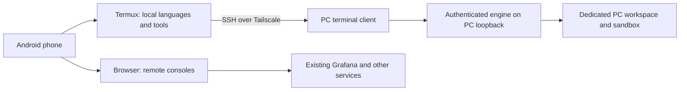

# Architecture

The phone provides local coding tools and access to remote development systems. Each operation should make its execution location clear.

The native v0.2 launcher adds search, app/service pins, and quick actions around these paths. Catalog imports remain in app-private preferences excluded from cloud and device-transfer backup. Public examples contain generic placeholders; private service addresses and inventories stay outside the source package. A remote Grafana entry opens an existing service; it does not install Grafana or Loki on the phone.

Service pins use stable catalog IDs, while app pins refer to installed application components. The evaluated imports retained the selected pins, and seven Home shortcuts survived force-stop/restart. Process restart acceptance does not establish full phone-reboot behavior.

Service URLs use HTTPS and open externally in Chrome when available. The AI-workspace and Grafana incident routes reached their login pages. A later authenticated Open WebUI check returned the requested exact response from an existing Ollama model. Authenticated Grafana Explore then returned the expected constant from `vector(1)` through an existing Loki datasource. This qualifies that bounded query path, while raw log access and ingestion remain unqualified.

## Phone tools

Termux provides the local shell, languages, compilers, Git, OpenSSH, and terminal utilities. Its packages run within Android's application environment. Native Tailscale supplies private network connectivity to Termux and the browser. [Termux](https://termux.dev/en/), [Tailscale Android installation](https://tailscale.com/docs/install/android)

Keep local actions separate from browser links and remote commands. Display the action type before execution. Catalog search should not imply that every listed tool has been installed or validated.

Local tool and Codex actions copy a fixed helper command and open Termux; the operator pastes and submits it. The launcher does not execute imported catalog content or invoke an external Termux command service. The new Codex action's copy/paste, SSH connection, and actual remote terminal ready prompt were observed without another model call. Earlier phone-initiated model coding remains a separate passed result.

## PC-backed Codex

The verified path uses SSH public-key authentication from the phone to the development PC. A PC terminal client connects to an authenticated Codex app-server bound to PC loopback. The engine runs in the signed-in desktop user's Windows session; the SSH client can run in a service session. This separation resolved an observed sandbox startup failure on the evaluated host.

PC account authentication and the app-server transport secret stay on the PC. The phone retains its own SSH private key in private application storage. Host-key verification and ordinary account authentication remain part of setup.

The app-server interface supports a remote terminal UI and explicit sandbox policies. This project's Windows session arrangement is an evaluated integration method, not a guarantee for every Windows installation. [Codex app-server documentation](https://learn.chatgpt.com/docs/app-server)

Use a dedicated workspace and review the effective policy shown in the terminal. Filesystem permissions, network access, and approval policy are separate controls. The bounded backend coding test denied network access. The final phone terminal used workspace access with network enabled and approval on request. [Codex permissions](https://learn.chatgpt.com/docs/permissions)

## Host lifecycle

The evaluated engine started through a limited per-user at-logon task. The PC must remain available with the designated user session and network connection. Full reboot/logon, sleep recovery, and network-switch recovery still need separate acceptance.

Preserve the host's selected model and account configuration unless the operator deliberately changes them. Validate the actual interpreter and shell available inside the sandbox; a host PATH check alone does not establish sandbox access.

## Display preference

The current development preference is `stay_on_while_plugged_in=7`, covering AC, USB, and wireless charging, and `screen_off_timeout=1800000`, giving a 30-minute battery timeout. Charging wakefulness was observed; sustained battery behavior was not measured. Device policy can impose additional limits. [Android stay-awake setting](https://developer.android.com/reference/android/provider/Settings.Global#STAY_ON_WHILE_PLUGGED_IN)

These preferences should be visible and reversible in any reusable setup flow. They do not change the screen-lock credential or establish behavior after every reboot.

## Appearance boundaries

The evaluated setup applied wallpaper to Home and lock screen, checked Android's wallpaper service state, and inspected the lock-screen preview. Android dark mode and its Lemongrass preset (`#DDEB78`) with Expressive styling were configured through normal appearance controls. Termux color application was also verified.

Outlands Home draws its own frames and geometric glyphs around local app icons and service shortcuts. It does not replace system UI or modify another application's icon resources or APK. Full phone reboot, arbitrary large-font layouts, tablet layouts, and multiuser behavior remain unqualified.
